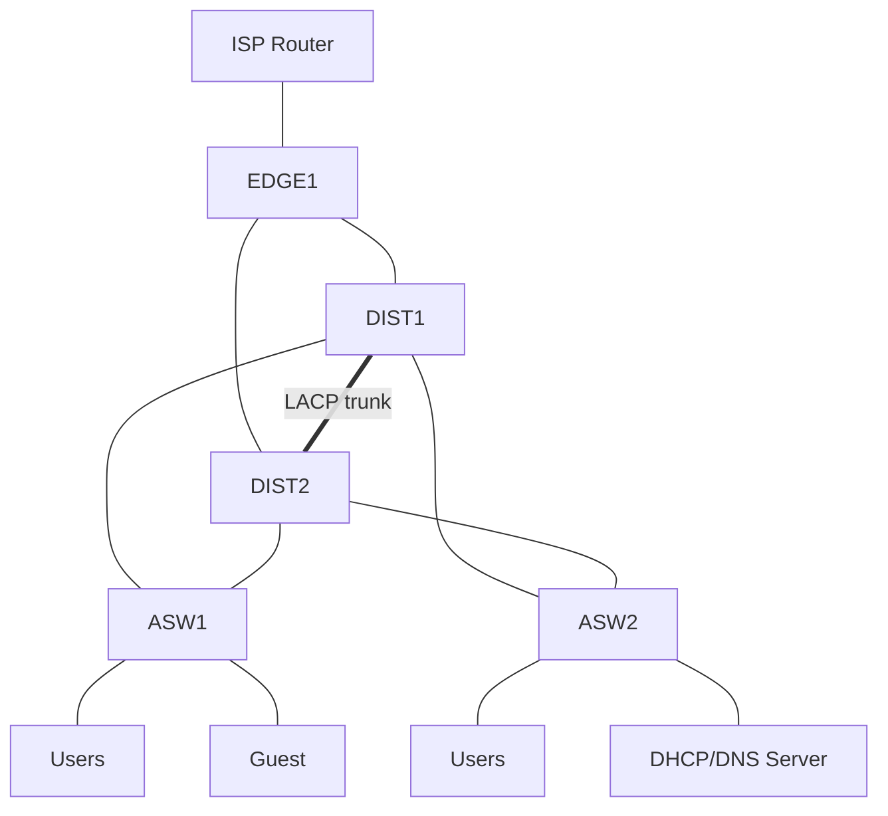

# Lab 01 — Resilient Enterprise Campus

## Scenario

Design a resilient headquarters campus for approximately 250 users. The network must continue operating through a distribution-switch or uplink failure, isolate guest traffic, use dynamic routing toward the Internet edge, and provide centralized DHCP.

## Skills Demonstrated

HSRP · VLANs · 802.1Q trunks · LACP EtherChannel · Rapid-PVST · Layer-3 switching · OSPF · DHCP relay · Extended ACL · NAT/PAT

## Suggested Packet Tracer Devices

- 1 × Cisco 2911 — `EDGE1`
- 2 × Cisco 3560 multilayer switches — `DIST1`, `DIST2`
- 2 × Cisco 2960 access switches — `ASW1`, `ASW2`
- 1 × server — DHCP/DNS
- 4–8 PCs
- 1 × ISP router

## Logical Topology



## VLAN / Addressing Plan

| VLAN | Name | Subnet | HSRP VIP | DIST1 | DIST2 |
|---|---|---|---|---|---|
| 10 | USERS | 10.10.10.0/24 | 10.10.10.1 | .2 | .3 |
| 20 | VOICE | 10.10.20.0/24 | 10.10.20.1 | .2 | .3 |
| 30 | SERVERS | 10.10.30.0/24 | 10.10.30.1 | .2 | .3 |
| 40 | GUEST | 10.10.40.0/24 | 10.10.40.1 | .2 | .3 |
| 99 | MANAGEMENT | 10.10.99.0/24 | 10.10.99.1 | .2 | .3 |

Transit:
- EDGE1 ↔ DIST1: `10.255.0.0/30` — EDGE1 .1, DIST1 .2
- EDGE1 ↔ DIST2: `10.255.0.4/30` — EDGE1 .5, DIST2 .6
- EDGE1 ↔ ISP: `203.0.113.0/30` — ISP .1, EDGE1 .2
- DHCP/DNS server: `10.10.30.10/24`, gateway `10.10.30.1`

## DIST1 Core Configuration

> Adapt physical interface numbers to the ports used in your Packet Tracer topology.

```ios
hostname DIST1
ip routing
spanning-tree mode rapid-pvst

vlan 10
 name USERS
vlan 20
 name VOICE
vlan 30
 name SERVERS
vlan 40
 name GUEST
vlan 99
 name MANAGEMENT

interface vlan 10
 ip address 10.10.10.2 255.255.255.0
 standby 10 ip 10.10.10.1
 standby 10 priority 120
 standby 10 preempt
 ip helper-address 10.10.30.10
 no shutdown

interface vlan 20
 ip address 10.10.20.2 255.255.255.0
 standby 20 ip 10.10.20.1
 standby 20 priority 100
 standby 20 preempt
 ip helper-address 10.10.30.10
 no shutdown

interface vlan 30
 ip address 10.10.30.2 255.255.255.0
 standby 30 ip 10.10.30.1
 standby 30 priority 120
 standby 30 preempt
 no shutdown

interface vlan 40
 ip address 10.10.40.2 255.255.255.0
 standby 40 ip 10.10.40.1
 standby 40 priority 100
 standby 40 preempt
 ip helper-address 10.10.30.10
 ip access-group GUEST-IN in
 no shutdown

interface vlan 99
 ip address 10.10.99.2 255.255.255.0
 standby 99 ip 10.10.99.1
 standby 99 priority 120
 standby 99 preempt
 ip helper-address 10.10.30.10
 no shutdown

ip access-list extended GUEST-IN
 deny ip 10.10.40.0 0.0.0.255 10.10.0.0 0.0.255.255
 permit ip 10.10.40.0 0.0.0.255 any

interface range gigabitEthernet0/1-2
 channel-group 1 mode active
 no shutdown

interface port-channel1
 switchport mode trunk
 switchport trunk allowed vlan 10,20,30,40,99

spanning-tree vlan 10,30,99 root primary
spanning-tree vlan 20,40 root secondary

interface fastEthernet0/24
 no switchport
 ip address 10.255.0.2 255.255.255.252
 no shutdown

router ospf 10
 router-id 1.1.1.1
 passive-interface default
 no passive-interface fastEthernet0/24
 network 10.10.0.0 0.0.255.255 area 0
 network 10.255.0.0 0.0.0.3 area 0
```

## DIST2 Differences

Use the same VLANs, with SVI addresses ending in `.3`. Make DIST2 active for VLANs 20 and 40.

```ios
hostname DIST2
ip routing
spanning-tree mode rapid-pvst

interface vlan 10
 ip address 10.10.10.3 255.255.255.0
 standby 10 ip 10.10.10.1
 standby 10 priority 100
 standby 10 preempt
 ip helper-address 10.10.30.10
 no shutdown

interface vlan 20
 ip address 10.10.20.3 255.255.255.0
 standby 20 ip 10.10.20.1
 standby 20 priority 120
 standby 20 preempt
 ip helper-address 10.10.30.10
 no shutdown

interface vlan 30
 ip address 10.10.30.3 255.255.255.0
 standby 30 ip 10.10.30.1
 standby 30 priority 100
 standby 30 preempt
 no shutdown

interface vlan 40
 ip address 10.10.40.3 255.255.255.0
 standby 40 ip 10.10.40.1
 standby 40 priority 120
 standby 40 preempt
 ip helper-address 10.10.30.10
 ip access-group GUEST-IN in
 no shutdown

interface vlan 99
 ip address 10.10.99.3 255.255.255.0
 standby 99 ip 10.10.99.1
 standby 99 priority 100
 standby 99 preempt
 ip helper-address 10.10.30.10
 no shutdown

spanning-tree vlan 20,40 root primary
spanning-tree vlan 10,30,99 root secondary

interface fastEthernet0/24
 no switchport
 ip address 10.255.0.6 255.255.255.252
 no shutdown

router ospf 10
 router-id 2.2.2.2
 passive-interface default
 no passive-interface fastEthernet0/24
 network 10.10.0.0 0.0.255.255 area 0
 network 10.255.0.4 0.0.0.3 area 0
```

## EDGE1

```ios
hostname EDGE1

interface g0/0
 description TO-ISP
 ip address 203.0.113.2 255.255.255.252
 ip nat outside
 no shutdown

interface g0/1
 description TO-DIST1
 ip address 10.255.0.1 255.255.255.252
 ip nat inside
 no shutdown

interface g0/2
 description TO-DIST2
 ip address 10.255.0.5 255.255.255.252
 ip nat inside
 no shutdown

access-list 10 permit 10.10.0.0 0.0.255.255
ip nat inside source list 10 interface g0/0 overload

ip route 0.0.0.0 0.0.0.0 203.0.113.1

router ospf 10
 router-id 10.10.10.10
 network 10.255.0.0 0.0.0.3 area 0
 network 10.255.0.4 0.0.0.3 area 0
 default-information originate
```

## Access Switch Template

```ios
hostname ASW1
spanning-tree mode rapid-pvst

vlan 10
vlan 20
vlan 30
vlan 40
vlan 99

interface g0/1
 description UPLINK-DIST1
 switchport mode trunk
 switchport trunk allowed vlan 10,20,30,40,99

interface g0/2
 description UPLINK-DIST2
 switchport mode trunk
 switchport trunk allowed vlan 10,20,30,40,99

interface range f0/1-12
 switchport mode access
 switchport access vlan 10
 spanning-tree portfast

interface range f0/13-18
 switchport mode access
 switchport access vlan 40
 spanning-tree portfast
```

## Verification

```ios
show standby brief
show etherchannel summary
show spanning-tree vlan 10
show spanning-tree vlan 20
show ip ospf neighbor
show ip route
show access-lists
show ip nat translations
```

## Failure Tests

1. Start continuous pings from a VLAN 10 PC to the ISP.
2. Shut the active HSRP SVI or power off DIST1.
3. Confirm the default gateway transitions to DIST2.
4. Restore DIST1 and confirm preemption.
5. Shut one EtherChannel member and verify the port-channel remains operational.
6. Confirm a Guest VLAN client cannot reach VLAN 10/30/99 but can reach the ISP.

## Portfolio Evidence

Capture:
- full topology
- `show standby brief`
- `show etherchannel summary`
- STP roots for VLAN 10 and VLAN 20
- OSPF neighbors and routing table
- guest ACL successful deny
- HSRP failover ping test
