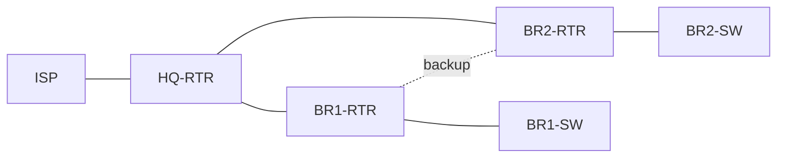

# Lab 02 — Multi-Site OSPF Enterprise WAN

## Scenario

Build a headquarters and two-branch enterprise WAN. The WAN is OSPF area 0, while each branch LAN is placed in its own OSPF area. Branch routers act as ABRs and summarize their site prefixes toward the backbone.

## Skills Demonstrated

OSPFv2 · multi-area design · ABR summarization · router-on-a-stick · DHCP · default-information originate · path-cost engineering · enterprise IP planning

## Topology



## Addressing

Backbone:
- HQ–BR1: `10.255.10.0/30` — HQ .1, BR1 .2
- HQ–BR2: `10.255.20.0/30` — HQ .1, BR2 .2
- BR1–BR2 backup: `10.255.30.0/30` — BR1 .1, BR2 .2

HQ LAN:
- `10.10.10.0/24`

Branch 1 / Area 10:
- VLAN 110 Users: `10.11.10.0/24`
- VLAN 120 Operations: `10.11.20.0/24`

Branch 2 / Area 20:
- VLAN 210 Users: `10.12.10.0/24`
- VLAN 220 Operations: `10.12.20.0/24`

## HQ Router

```ios
hostname HQ-RTR

interface g0/0
 ip address 10.10.10.1 255.255.255.0
 no shutdown

interface s0/0/0
 ip address 10.255.10.1 255.255.255.252
 clock rate 64000
 no shutdown

interface s0/0/1
 ip address 10.255.20.1 255.255.255.252
 clock rate 64000
 no shutdown

interface g0/1
 description TO-ISP
 ip address 203.0.113.2 255.255.255.252
 no shutdown

ip route 0.0.0.0 0.0.0.0 203.0.113.1

router ospf 20
 router-id 10.10.10.10
 network 10.10.10.0 0.0.0.255 area 0
 network 10.255.10.0 0.0.0.3 area 0
 network 10.255.20.0 0.0.0.3 area 0
 default-information originate
```

## Branch 1 Router

```ios
hostname BR1-RTR

interface s0/0/0
 ip address 10.255.10.2 255.255.255.252
 no shutdown

interface s0/0/1
 description BACKUP-TO-BR2
 ip address 10.255.30.1 255.255.255.252
 ip ospf cost 200
 no shutdown

interface g0/0
 no shutdown

interface g0/0.110
 encapsulation dot1Q 110
 ip address 10.11.10.1 255.255.255.0

interface g0/0.120
 encapsulation dot1Q 120
 ip address 10.11.20.1 255.255.255.0

ip dhcp excluded-address 10.11.10.1 10.11.10.20
ip dhcp excluded-address 10.11.20.1 10.11.20.20

ip dhcp pool BR1-USERS
 network 10.11.10.0 255.255.255.0
 default-router 10.11.10.1
 dns-server 8.8.8.8

ip dhcp pool BR1-OPS
 network 10.11.20.0 255.255.255.0
 default-router 10.11.20.1
 dns-server 8.8.8.8

router ospf 20
 router-id 11.11.11.11
 network 10.255.10.0 0.0.0.3 area 0
 network 10.255.30.0 0.0.0.3 area 0
 network 10.11.10.0 0.0.0.255 area 10
 network 10.11.20.0 0.0.0.255 area 10
 area 10 range 10.11.0.0 255.255.0.0
```

## Branch 2 Router

```ios
hostname BR2-RTR

interface s0/0/0
 ip address 10.255.20.2 255.255.255.252
 no shutdown

interface s0/0/1
 description BACKUP-TO-BR1
 ip address 10.255.30.2 255.255.255.252
 ip ospf cost 200
 no shutdown

interface g0/0
 no shutdown

interface g0/0.210
 encapsulation dot1Q 210
 ip address 10.12.10.1 255.255.255.0

interface g0/0.220
 encapsulation dot1Q 220
 ip address 10.12.20.1 255.255.255.0

ip dhcp excluded-address 10.12.10.1 10.12.10.20
ip dhcp excluded-address 10.12.20.1 10.12.20.20

ip dhcp pool BR2-USERS
 network 10.12.10.0 255.255.255.0
 default-router 10.12.10.1
 dns-server 8.8.8.8

ip dhcp pool BR2-OPS
 network 10.12.20.0 255.255.255.0
 default-router 10.12.20.1
 dns-server 8.8.8.8

router ospf 20
 router-id 12.12.12.12
 network 10.255.20.0 0.0.0.3 area 0
 network 10.255.30.0 0.0.0.3 area 0
 network 10.12.10.0 0.0.0.255 area 20
 network 10.12.20.0 0.0.0.255 area 20
 area 20 range 10.12.0.0 255.255.0.0
```

## Branch Switch Template

```ios
vlan 110
 name USERS
vlan 120
 name OPERATIONS

interface g0/1
 switchport mode trunk

interface range f0/1-12
 switchport mode access
 switchport access vlan 110
 spanning-tree portfast

interface range f0/13-20
 switchport mode access
 switchport access vlan 120
 spanning-tree portfast
```

For Branch 2, use VLANs 210/220.

## Verification

```ios
show ip ospf neighbor
show ip ospf database
show ip route ospf
show ip protocols
show ip dhcp binding
traceroute 10.12.10.10
```

Expected HQ routing behavior should show summarized branch routes when summarization is operating.

## Failure Test

Shut the HQ–BR1 primary WAN link. Traffic between BR1 and HQ should reconverge through BR2 using the higher-cost backup backbone path.

Document:
- routing table before failure
- routing table after failure
- traceroute before/after
- convergence result
