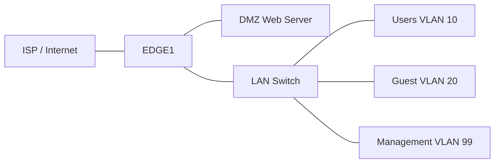

# Lab 03 — Secure Internet Edge & DMZ

## Scenario

Design an Internet edge for a medium enterprise. Internal users require outbound Internet access. A public web server must be reachable from the Internet, but the DMZ and management network must remain isolated. Device management must use SSH.

## Skills Demonstrated

NAT overload · static NAT/PAT · extended ACLs · DMZ segmentation · guest isolation · SSH hardening · switch port security · least-privilege design

## Addressing

- ISP ↔ EDGE1: `198.51.100.0/29`
  - ISP: `198.51.100.1`
  - EDGE1: `198.51.100.2`
  - Public web service: `198.51.100.3`
- Internal Users VLAN 10: `10.50.10.0/24`
- Guest VLAN 20: `10.50.20.0/24`
- Management VLAN 99: `10.50.99.0/24`
- DMZ: `172.16.50.0/24`
- DMZ Web Server: `172.16.50.10`

## Topology



## EDGE1 Configuration

```ios
hostname EDGE1
ip domain-name corp.example
username netadmin privilege 15 secret Str0ng-Lab-Password

crypto key generate rsa
1024
ip ssh version 2

line vty 0 4
 login local
 transport input ssh

interface g0/0
 description OUTSIDE
 ip address 198.51.100.2 255.255.255.248
 ip nat outside
 ip access-group OUTSIDE-IN in
 no shutdown

interface g0/1
 no shutdown

interface g0/1.10
 encapsulation dot1Q 10
 ip address 10.50.10.1 255.255.255.0
 ip nat inside

interface g0/1.20
 encapsulation dot1Q 20
 ip address 10.50.20.1 255.255.255.0
 ip nat inside
 ip access-group GUEST-IN in

interface g0/1.99
 encapsulation dot1Q 99
 ip address 10.50.99.1 255.255.255.0
 ip nat inside

interface g0/2
 description DMZ
 ip address 172.16.50.1 255.255.255.0
 ip nat inside
 ip access-group DMZ-IN in
 no shutdown

ip access-list standard NAT-USERS
 permit 10.50.10.0 0.0.0.255
 permit 10.50.20.0 0.0.0.255

ip nat inside source list NAT-USERS interface g0/0 overload
ip nat inside source static tcp 172.16.50.10 80 198.51.100.3 80
ip nat inside source static tcp 172.16.50.10 443 198.51.100.3 443

ip access-list extended OUTSIDE-IN
 permit tcp any host 198.51.100.3 eq 80
 permit tcp any host 198.51.100.3 eq 443
 permit tcp any any established
 permit udp any eq 53 any gt 1023
 permit icmp any any echo-reply
 permit icmp any any time-exceeded
 permit icmp any any unreachable
 deny ip any any log

ip access-list extended GUEST-IN
 deny ip 10.50.20.0 0.0.0.255 10.50.0.0 0.0.255.255
 deny ip 10.50.20.0 0.0.0.255 172.16.50.0 0.0.0.255
 permit ip 10.50.20.0 0.0.0.255 any

ip access-list extended DMZ-IN
 permit tcp host 172.16.50.10 any established
 permit udp host 172.16.50.10 any eq 53
 deny ip 172.16.50.0 0.0.0.255 10.50.0.0 0.0.255.255 log
 permit ip 172.16.50.0 0.0.0.255 any

ip route 0.0.0.0 0.0.0.0 198.51.100.1
```

## Access Switch Security

```ios
hostname ACCESS1
ip domain-name corp.example
username netadmin privilege 15 secret Str0ng-Lab-Password
crypto key generate rsa
1024
ip ssh version 2

vlan 10
 name USERS
vlan 20
 name GUEST
vlan 99
 name MANAGEMENT

interface g0/1
 description TRUNK-TO-EDGE
 switchport mode trunk
 switchport trunk allowed vlan 10,20,99

interface range f0/1-12
 switchport mode access
 switchport access vlan 10
 switchport port-security
 switchport port-security maximum 2
 switchport port-security violation restrict
 switchport port-security mac-address sticky
 spanning-tree portfast

interface range f0/13-18
 switchport mode access
 switchport access vlan 20
 spanning-tree portfast

interface vlan 99
 ip address 10.50.99.2 255.255.255.0
 no shutdown

ip default-gateway 10.50.99.1

line vty 0 4
 login local
 transport input ssh
```

## Verification Matrix

| Test | Expected |
|---|---|
| Internal user → Internet | Allowed through PAT |
| Internet → public web IP TCP/80 | Allowed |
| Internet → internal 10.50.10.0/24 | Denied |
| Guest → internal user VLAN | Denied |
| Guest → DMZ | Denied |
| Management host → EDGE SSH | Allowed |
| Telnet to EDGE | Denied |
| DMZ server → internal LAN | Denied |

Commands:

```ios
show ip nat translations
show ip nat statistics
show access-lists
show ip ssh
show port-security interface f0/1
show running-config | section line vty
```

## Portfolio Evidence

Capture the web server being accessed from an Internet-side PC using the public translated IP, then show ACL/NAT output proving the policy path.
